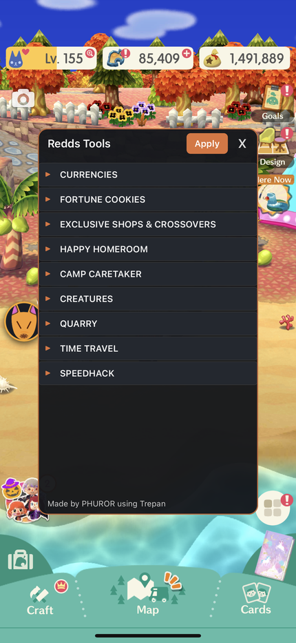
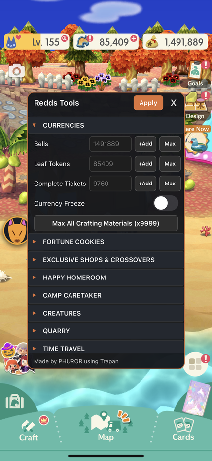
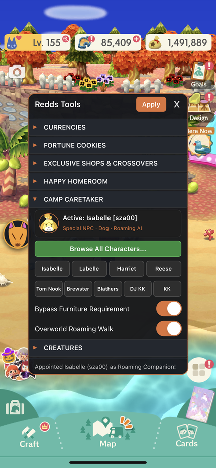
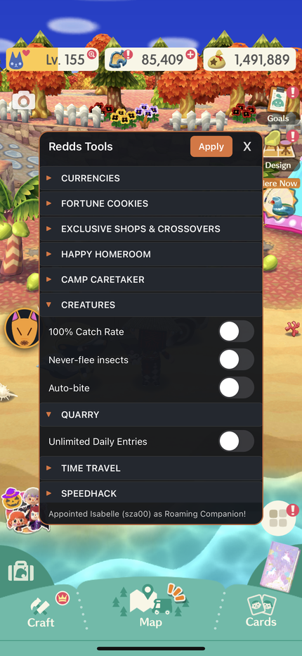
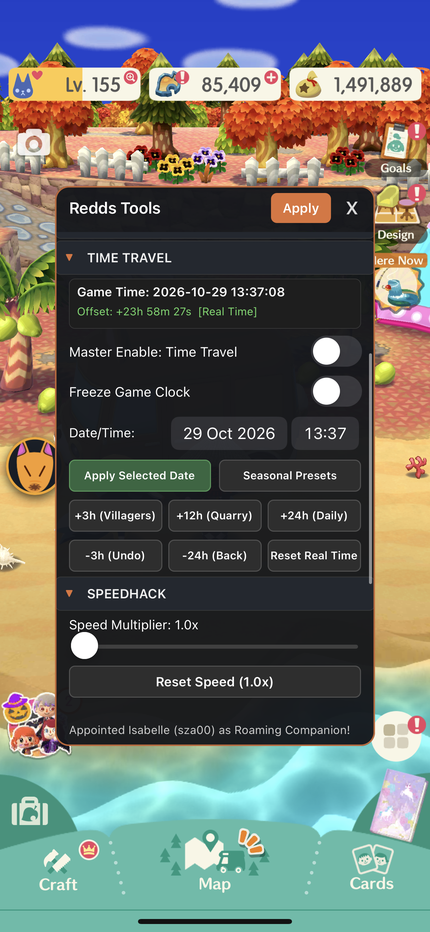
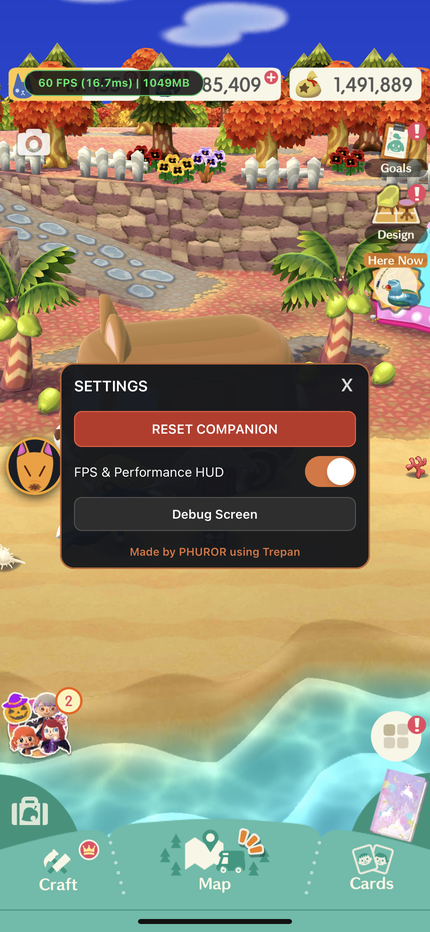

<p align="center">
  
</p>

<h1 align="center">Redds Tools</h1>

<p align="center">
  <strong>Floating In-Game Mod Menu for Animal Crossing: Pocket Camp Complete</strong><br>
  <em>In-process UIKit overlay for iOS (arm64) with native IL2CPP hooks and memory gates</em>
</p>

<p align="center">
  
  
  
  
</p>

---

## 1. Description

ReddsTools is a standalone, in-process UIKit floating modification menu engineered specifically for *Animal Crossing: Pocket Camp Complete* (`com.nintendo.zasa`, v7.1.4 Build 270). It hooks directly into the game's Unity IL2CPP runtime, modifying balances, bypassing progression restrictions, enabling companion walk mechanics, and providing bidirectional time travel without external background daemons or network proxies.

---

## 2. Features

<p align="center">
  
  
  
</p>

### 1. Currencies
- **Bells Editor:** Input exact Bell balances, tap `+Add` for +1,000,000, or tap `Max` for 9,999,999 Bells.
- **Leaf Tokens Editor:** Input exact Leaf Token balances, tap `+Add` for +1,000, or tap `Max` for 99,999 Tokens.
- **Complete Tickets Editor:** Input exact Complete Ticket balances, tap `+Add` for +100, or tap `Max` for 9,999 Tickets.
- **Currency Freeze:** Prevents active Bell, Leaf Token, and Complete Ticket balances from depleting during purchases and crafting.
- **Max Crafting Materials:** One-tap button that maxes out all bag crafting materials (Wood, Steel, Cotton, Paper, Preserves, and all Essences) to 999, and Friend Powder to 9,999.

### 2. Fortune Cookies
- **Unlock Crossover Cookies (Shop):** Adds crossover fortune cookies (Sanrio Characters, Splatoon, etc.) directly into the in-game Fortune Cookie Shop.

### 3. Exclusive Shops & Crossovers
- **Unlock Full Catalog:** Unlocks all crossover items, seasonal event exclusives, and Complete Ticket catalog items for viewing and immediate crafting.

### 4. Happy Homeroom
- **Infinite Tickets & Free Vouchers:** Take Happy Homeroom interior design classes without consuming Golden or Normal event tickets.
- **Auto-Pass 3 Medals (Instant Win):** Automatically scores maximum medals (3 stars) on any entered class evaluation.
- **Universal Furniture (Flawless):** Overrides class item validation so any submitted furniture item registers with a "Flawless!" score.

### 5. Camp Caretaker (Strategy B)
- **Active Companion Card:** Live HUD displaying the currently appointed companion name, species, NPC ID, and avatar, alongside an instant `Dismiss` button.
- **Character Browser Modal:** Searchable modal with real-time text filter and category tabs (`All (474)`, `Special (60)`, `Villagers (413)`).
- **60 Special NPCs Supported:** Direct selection of major NPCs including Isabelle, Tom Nook, Brewster, Blathers, DJ KK, KK Slider, Labelle, Harriet, Reese, and Redd.
- **Quick Assign Shortcuts:** Instant companion buttons for popular Special NPCs directly on the main menu panel.
- **Bypass Furniture Requirement:** Memory gate allowing any Special NPC to be appointed as Camp Caretaker without crafting or owning their special Leaf Token furniture.
- **Overworld Roaming Walk:** Enables companion locomotion AI so the appointed character follows the player character across campsites, cabins, and overworld recreation spots in real time.
- **Notice on Crashing Characters:** Certain Special NPCs or non-standard character models lack complete walking animations or valid overworld state machines and may crash the game upon spawning. Users encountering a crashing character ID are advised to **open an issue on GitHub** so the character can be blacklisted or patched. If your game crashes, refer to [Section 4: Camp Caretaker Stability Warning & Emergency Overwrite](#4-camp-caretaker-stability-warning--emergency-overwrite) for immediate recovery.

<p align="center">
  
  
  
</p>

### 6. Creatures
- **100% Catch Rate:** Enforces guaranteed capture success for all rare event creatures and garden bugs by routing through `PaidCatch`.
- **Never-Flee Insects:** Disables bug escape reactions so rare beetles and butterflies never fly away.
- **Auto-Bite:** Eliminates fish nibble delays so fish strike the lure instantly on first contact.

### 7. Quarry
- **Unlimited Daily Entries:** Memory gate removing the limit of 3 daily entries for Shovelstrike Quarry.

### 8. Time Travel
- **Live Game Clock HUD:** Real-time updating display showing current effective in-game time, active offset, and status (`Real Time`, `SPOOFED`, `FROZEN`).
- **Master Enable:** Toggles in-process interception of `NDcube.Type.UtcTime.get_Now`.
- **Freeze Game Clock:** Halts in-game clock advancement.
- **Date/Time Selector:** Embedded `UIDatePicker` allowing direct jumping to any year, month, day, hour, and minute.
- **Seasonal Presets:** Instant jumps to major festivals (Halloween, Toy Day, Cherry Blossoms, Summer Island, New Year Countdown).
- **Quick Jumps:** `+3h (Villagers)`, `+12h (Quarry)`, `+24h (Daily)`, `-3h (Undo)`, `-24h (Back)`, and `Reset Real Time`.
- **Anti-Save-Pollution:** Automatically commits true hardware POSIX time during save routines so future spoofed timestamps never poison the save file.

### 9. Speedhack
- **Speed Multiplier:** Smooth slider from 1.0x to 10.0x accelerating game animations, dialogue text, and overworld traversal via `Time.set_timeScale`.
- **Reset Speed (1.0x):** One-tap button restoring default 1.0x speed.

### 10. Diagnostics & Settings Panel (Long-Press on Floating Icon)
- **RESET COMPANION:** Emergency recovery button immediately restoring a safe companion (Isabelle / `sza00`).
- **FPS & Performance HUD:** Live top-screen overlay displaying frame rate, frame time in milliseconds, and resident memory usage.
- **Debug Screen:** Invokes native Unity Universal Render Pipeline (URP) performance diagnostics.

---

## 3. Installation

ReddsTools supports three distinct deployment workflows tailored to device capabilities and user preference:

| Method | Target Environment | JIT Required? | Feature Coverage | Installation Complexity |
| :--- | :--- | :--- | :--- | :--- |
| **Method 1: Jailbroken Rootless .deb** | Jailbroken (Dopamine, Palera1n) | Yes (Substrate/ElleKit) | **100% (All Features)** | Simple (Sileo / Zebra / dpkg) |
| **Method 2: Jailed Standalone .dylib** | Sideloaded / Non-Jailbroken | No | **Core Menu & Currencies** | Simple (Sideloadly / TrollStore) |
| **Method 3: Hybrid Patched IPA** | Sideloaded / Non-Jailbroken | No (Static + `__DATA` Bridge) | **100% (Full Feature Parity)** | Automated Script / AI Agent |

---

### Method 1: iOS Rootless Jailbreak (.deb — Full Feature Set)
For rootless jailbroken devices running iOS 15.0 – 16.x+ (Dopamine, Palera1n, XinaA15).

- **Features:** 100% of all 10 modules function dynamically with real-time toggle switches via native ElleKit/Substrate hooks (`MSHookFunction`).
- **Installation:**
  1. Download the pre-compiled `ReddsTools_rootless.deb` from [GitHub Releases](https://github.com/Sivenesis/ReddsTools/releases).
  2. Install via Sileo, Zebra, Filza, or terminal:
     ```bash
     dpkg -i ReddsTools_rootless.deb
     ```
  3. Launch *Animal Crossing: Pocket Camp Complete*. The draggable Redd icon appears over the screen.

---

### Method 2: Jailed Standalone .dylib (Simple IPA Injection — Lite Mode)
For non-jailbroken devices using sideloading utilities (TrollStore, Sideloadly, Esign, Feather, Scarlet, AltStore).

This method injects `ReddsTools_lite_inject.dylib` into an unmodded, decrypted ACPCC `.ipa` without altering the game's executable binaries.

- **What Works:**
  - In-process UIKit floating menu overlay and HUD (`v1.5.0 Lite`).
  - Currencies Editor: Input exact Bells, Leaf Tokens, Complete Tickets with direct IL2CPP memory writes.
  - Complete Tickets live stock balance reading.
  - Camp Caretaker companion browser modal (search, category tabs, all 478 Animal Crossing characters with embedded offline database and all 478 portrait PNG icons baked directly into the standalone dylib binary — no separate asset bundles required).
  - Special NPC Quick Appoint buttons (Isabelle, Tom Nook, Brewster, Blathers, KK, DJ KK, Labelle, Harriet, Reese).
  - Overworld Roaming Walk toggle.
  - Speedhack Multiplier (1.0x to 10.0x via Unity `Time.set_timeScale`).
  - FPS, Performance HUD, and URP debug diagnostics.
- **What Is Cut/Disabled (No-JIT Limitations):**
  - Due to iOS W^X (Write XOR Execute) memory restrictions and the absence of JIT on jailed devices, runtime function detour hooks (`MSHookFunction`) into `UnityFramework` executable memory (`__TEXT`) cannot be established without static binary patching.
  - Time Travel, Shovelstrike Quarry unlimited entries, Crossover Cookie purchase bypasses, Full Catalog unlocks, Happy Homeroom auto-pass, and 100% creature catch rates are omitted from this reduced menu.
- **Installation:**
  - **Using Sideloadly:** Select decrypted `.ipa`, open "Advanced Options", add `ReddsTools_lite_inject.dylib` under "Tweak Injection", and click Start.
  - **Using TrollStore / Esign / Feather:** Import decrypted `.ipa`, select "Inject / Add Dynamic Library", choose `ReddsTools_lite_inject.dylib`, and sign the application.

---

### Method 3: Hybrid Approach (Full Feature Parity on Jailed iOS)
For non-jailbroken devices that want **100% feature parity** (including interactive Time Travel, Crossover Cookie purchasing, Full Catalog, Instant Crafting, Happy Homeroom, and Unlimited Quarry Entries) without a jailbreak or JIT.

This approach combines:
1. **32 Static Binary Memory Gates** pre-baked directly into `UnityFramework.framework/UnityFramework` `__TEXT`.
2. **JIT-Free `__DATA` Pointer Bridge:** A trampoline at `UtcTime.get_Now` (`0x1E2B904`) that routes in-game time checks into `ReddsTools.dylib` through a writable memory slot (`base + 0x7715B00`), allowing interactive time shifting (+3h, +12h, +24h, custom date picker, clock freeze) without JIT.
3. **In-Process Dylib & Assets:** Staged with `characters.json` and 478 companion icons inside `Payload/zasa.app/ReddsTools/`.

> [!IMPORTANT]
> **User-Provided IPA Requirement:**  
> Users **must provide their own decrypted `.ipa`** of *Animal Crossing: Pocket Camp Complete* version **7.1.4** (Build 270). This repository strictly adheres to copyright policies and does not distribute proprietary Nintendo game binaries or decrypted IPAs.

> [!TIP]
> **Recommended Workflow — Use an AI Coding Agent:**  
> The simplest, fastest, and most error-free way to produce the hybrid IPA is to **feed [`HYBRID_IPA_PATCHING_GUIDE.md`](HYBRID_IPA_PATCHING_GUIDE.md) along with your decrypted ACPCC 7.1.4 `.ipa` to an AI coding agent** (such as Antigravity, Claude Code, Cursor, Copilot Workspace, or ChatGPT).
>
> The guide contains the exact byte-level specification for all 32 memory gates, Mach-O load command injection details, and asset staging paths. The AI agent can automatically run the patch pipeline and return your ready-to-sideload `ACPCC_7.1.4_Hybrid.ipa` in seconds.

- **Automated Patcher Bundle:**
  Download `ReddsTools_v1.5.0_Hybrid_Patcher.zip` from [GitHub Releases](https://github.com/Sivenesis/ReddsTools/releases).
  1. Unzip the package (contains `create_hybrid_ipa.py`, `ReddsTools_hybrid_inject.dylib`, `HYBRID_IPA_PATCHING_GUIDE.md`, `characters.json`, and `icons/`).
  2. Run the patcher with your decrypted ACPCC 7.1.4 IPA:
     ```bash
     python create_hybrid_ipa.py path/to/ACPCC_7.1.4.ipa
     ```
  3. Sideload the resulting `ACPCC_7.1.4_Hybrid.ipa` using TrollStore, Sideloadly, or Esign.

---

## 4. Camp Caretaker Stability Warning & Emergency Overwrite

Certain Special NPCs or incomplete character models lack walking animations or valid overworld locomotion AI. Appointing an unsupported character as your Camp Caretaker can cause the game client to crash during overworld loading.

If you encounter an NPC that triggers a crash, please **open an issue on GitHub** stating the character name and ID so it can be added to the auto-sanitization blacklist.

<p align="center">
  
</p>

### Emergency Rescue Mechanisms

If the game crashes upon launch or becomes unresponsive due to a crashing companion:

1. **Floating Icon Double-Tap:** Double-tap the floating Redd avatar icon on the screen at any point.
2. **Settings Panel Reset:** Long-press the floating Redd icon to open Settings, then tap **RESET COMPANION**.

Both mechanisms immediately force-appoint a verified standard character (Isabelle / `sza00`) and set an automatic boot-recovery flag that cleanses persistent companion state on next boot.

---

## 5. Intellectual Property & Copyright Notice

*Animal Crossing: Pocket Camp Complete*, *Animal Crossing*, character names, textures, and associated media are registered trademarks and copyrights of **Nintendo Co., Ltd.**

ReddsTools is an independent, community-driven reverse-engineering project created strictly for personal entertainment, research, and noncommercial offline game preservation. This repository contains no proprietary game code, decrypted game binaries, or proprietary database files.

---

## 6. "As Is" Warranty & Liability Disclaimer

This software is provided by the copyright holders and contributors "as is" and any express or implied warranties, including, but not limited to, the implied warranties of merchantability and fitness for a particular purpose are disclaimed. In no event shall the authors or contributors be liable for any direct, indirect, incidental, special, exemplary, or consequential damages (including loss of save game data, application instability, or device malfunction) however caused and on any theory of liability, whether in contract, strict liability, or tort arising in any way out of the use of this software.

---

## 7. AI Assistance Disclosure

Portions of this codebase, technical documentation, and reverse-engineering research blueprints were authored, analyzed, and structured with the assistance of Artificial Intelligence (AI) models. Users, researchers, and developers should independently review and verify implementation details before deployment.

---

## Documentation & License

- Complete Technical Architecture & Reverse Engineering Specification: [RESEARCH.md](RESEARCH.md)
- Hybrid Jailed IPA Patching Guide: [HYBRID_IPA_PATCHING_GUIDE.md](HYBRID_IPA_PATCHING_GUIDE.md)
- Feasibility Analysis: [docs/IOS_FLOATING_MENU_FEASIBILITY_REPORT.md](docs/IOS_FLOATING_MENU_FEASIBILITY_REPORT.md)
- Developer Flags & Anti-Cheat Analysis: [docs/DEVELOPER_SYSTEMS_AND_ANTI_CHEAT_ANALYSIS.md](docs/DEVELOPER_SYSTEMS_AND_ANTI_CHEAT_ANALYSIS.md)
- Time Spoofing Specification: [docs/DATE_AND_TIME_SPOOFING_SPECIFICATION.md](docs/DATE_AND_TIME_SPOOFING_SPECIFICATION.md)
- Camp Caretaker Strategy B: [docs/STRATEGY_B_CAMP_CARETAKER_COMPANION_BYPASS.md](docs/STRATEGY_B_CAMP_CARETAKER_COMPANION_BYPASS.md)
- License: [PolyForm Noncommercial License 1.0.0](LICENSE)
