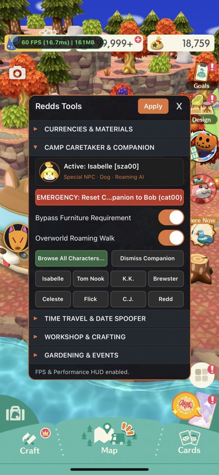
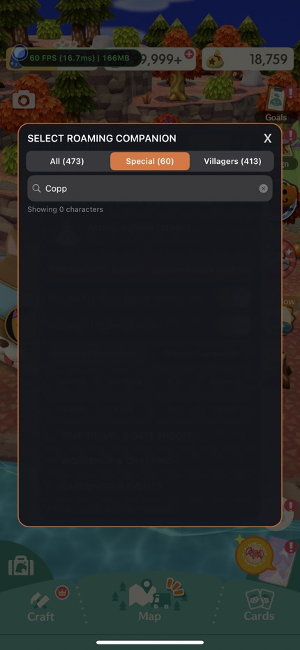
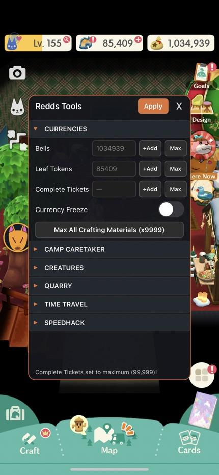

<p align="center">
  
</p>

<h1 align="center">ReddsTools</h1>

<p align="center">
  <strong>Floating In-Game Mod Menu for Animal Crossing: Pocket Camp Complete</strong><br>
  <em>Rootless iOS Jailbreak Tweak (arm64) with IL2CPP Runtime Hooks and Memory Gates</em>
</p>

<p align="center">
  
  
  
  
</p>

---

## Overview

**ReddsTools** is a standalone, in-process UIKit floating modification menu engineered specifically for *Animal Crossing: Pocket Camp Complete* (`com.nintendo.zasa`, v7.1.4 Build 270). Named after Crazy Redd, it embeds directly into the game process without requiring external daemons, proxies, or network tampering.

Because *Pocket Camp Complete* is an offline, single-player title with network verification layers (Sakasho) excised, currency balances, craft queues, friendship states, gardening timers, and date systems exist locally in memory. Disassembly of `UnityFramework` demonstrates that all 863+ time checks across 657 classes query a single chokepoint: `NDcube.Type.UtcTime.get_Now` (RVA `0x1E2B904`). ReddsTools hooks this method alongside anti-save-pollution handlers, providing bidirectional time travel and clock spoofing without requiring iOS Settings clock adjustments.

---

## Screenshots

<p align="center">
  
  &nbsp;&nbsp;
  
  &nbsp;&nbsp;
  
</p>

---

## Features

### 1. Currencies & Materials
- **Bells Editor**: Set exact Bell balance, add +1,000,000 Bells, or max out at 9,999,999 Bells. Values are updated via `UserProfileEntry.set_Bell` and `GuardLong.set_Value`.
- **Leaf Tokens Editor**: Set exact Leaf Token balance, add +1,000 Tokens, or max out at 99,999 Tokens via `UserProfileEntry.set_NewLeafTicket` and `GuardLong.set_Value`.
- **Max All Crafting Materials**: One-tap injection updating Wood, Steel, Cotton, Paper, Preserves, and all Essences in active bag storage to 999 using `UserOfflineMaterialBagOneSlotEntry.set_Num` and `GuardShort.set_Value`.
- **Currency Freeze**: Lock active Bell and Leaf Token balances with a 0.5s timer loop to prevent depletion during crafting and purchases.

### 2. Camp Caretaker & Roaming Companion (Strategy B)
- **Universal Furniture Ownership Bypass**: Memory gate and Substrate hook intercepting `NDcube.Cmps.App.Assistant.Registration.RegistrationChecker.CanRegister` (RVA `0x25D74C8`). Bypasses the requirement to craft, own, or place expensive Leaf Token special furniture (`AppointmentFurnitureID`), unlocking all 65 Special NPCs (Tom Nook, Isabelle, K.K. Slider, Brewster, Celeste, Flick, C.J., Redd, and more) directly in the native caretaker selection UI.
- **Overworld Roaming Walk Companion**: Invokes `NDcube.Cmps.App.Assistant.AssistantManager.SetWalkWithEnabled` (RVA `0x25D5960`) via `WalkWithFacade`. Enables real-time overworld companion locomotion and pathfinding so the companion follows the player character across campsites, cabins, and recreation spots without requiring scene reloads.
- **Interactive Character Selector Modal (478 Characters)**:
  - Searchable collection view grid (`UICollectionView`) featuring all 478 characters (35 animal species + 65 Special NPCs) extracted directly from ACPCC game data.
  - Category tabs: `All (478)`, `Special (65)`, and `Villagers (413)`.
  - Real-time search filter matching character names (e.g., "Isabelle", "Raymond", "Brewster", "Redd", "Marshal").
  - Official character icons rendered with lazy loading and memory caching (`NSCache`).
  - Active selection indicator with green highlight ring.
- **One-Tap Quick Assign Shortcuts**: Instant companion buttons for popular Special NPCs directly on the main floating menu:
  - Isabelle (`npc00`), Tom Nook (`npc01`), K.K. Slider (`npc02`), Brewster (`npc07`), Celeste (`npc08`), Flick (`npc49`), C.J. (`npc50`), Crazy Redd (`npc11`).
- **Active Companion HUD & Controls**:
  - Displays currently registered companion icon and name.
  - Overworld walk toggle.
  - Interactive selector launcher modal.
  - Dismiss button invoking `AssistantManager.UnregisterAssistantNpc` (RVA `0x25D4DB8`).

### 3. Time Travel & Date Spoofer
- **Master Enable Switch**: Activates in-process interception of `NDcube.Type.UtcTime.get_Now` (RVA `0x1E2B904`). Bypasses the vanilla anti-backwards-travel clamp against `_lastPlayUnixTime`.
- **Anti-Save-Pollution Protection**: Hooks `NDcube.Cmps.Sys.User.CmpsUserBoot.SetLastTimeInfo` (RVA `0x212BDD8`). Intercepts game save writes and commits genuine real-world POSIX time instead of future spoofed timestamps. If the tweak is uninstalled, the player's vanilla save remains valid and unclamped.
- **Arbitrary Date & Time Selector**: Embedded compact `UIDatePicker` allowing direct selection of any year, month, day, hour, and minute with an explicit `Apply Selected Date` action.
- **Seasonal Event Presets**: One-tap action sheet to leap directly into major seasonal festivals:
  - Halloween (Jack's Spooky Event - Oct 31, 15:00 UTC)
  - Toy Day (Jingle's Christmas - Dec 24, 06:00 UTC)
  - Cherry Blossoms (Spring Festival - Apr 10, 06:00 UTC)
  - Summer Island (Fireworks & Beetles - Jul 15, 06:00 UTC)
  - New Year Countdown (Jan 01, 00:00 UTC)
- **Quick Jumps**:
  - `+3h (Villagers)`: Instantly cycles recreation spot animal visitors and request pools.
  - `+12h (Quarry)`: Resets the Shovelstrike Quarry mineral lottery reward pool.
  - `+24h (Daily)`: Triggers global dateline restock (Fortune Cookie cart, daily bonuses).
  - `-3h (Undo)`: Shifts time backward by 3 hours.
  - `-24h (Back)`: Shifts time backward by 24 hours.
  - `Reset Real Time`: Immediately clears active offset and restores real hardware clock.
- **Game Clock Freeze**: Freezes the active in-game timestamp so time does not tick forward.
- **Live Game Clock HUD**: Real-time 1-second updating display showing current effective game time and active offset with color-coded status (`Real Time`, `SPOOFED`, `FROZEN`).

### 4. Workshop & Crafting
- **Instant Crafting**: Memory gates `UserCraftFtrClothNowWorkOneSlotSetElement.get_CompleteDate` (RVA `0x29AB41C`) to return 0 and `get_RecipeTime` (RVA `0x29AB5B4`) to return 0s, immediately completing any active furniture, clothing, or campsite amenities.

### 5. Gardening & Events
- **Instant Bloom (All 20 Plots)**: One-tap button scanning all 20 flowerbed slots in memory (`UserOfflineFlowerbedOneSlotEntry`), writing `SecToComplete = 0` and `SecToBud = 0`.
- **Always Instant Bloom**: Runtime memory gate forcing seeds to bloom into mature flowers immediately upon planting.
- **100% Creature Catch Rate**: Substrate hook intercepting `CmpsSksGardening.Catch` (RVA `0x2B438D8`) and routing to `PaidCatch` (RVA `0x2B43DDC`), enforcing Lloid's 100% guaranteed catch rate for all rare event creatures.

### 6. Fishing & Bug Hunting
- **Auto-Bite (No Nibble Delay)**: Hooks `FishBite.OnStart` (RVA `0x28A0A94`), resetting `_bite_time` to 0.0s so fish strike on the initial lure contact.
- **Instant Fish Pull**: Memory gate on `CmpsFieldFish.isPull` (RVA `0x23F7E24`) forcing the hook flag immediately.
- **Never-Flee Insects**: Memory gate disabling `CmpsFieldInsect.ReactionEscape` (RVA `0x24141F0`) and forcing `IsEscaped` (RVA `0x2414748`) to return `false`.

### 7. Villagers & Campsite
- **Max Friendship (All Animals Lvl 70+)**: Scans all active `UserAnimalInfoOneSlotEntry` entries in memory, setting heart levels and caps to 70+.
- **Fulfill Active Requests**: Sets `IsReqDone` and `IsCampsiteReqDone` to `true` for all visiting animals.
- **Campsite Villager Force-Spawner**: Substrate hook on `CmpsGameDebugSetting.get_MyCampsiteNpcLabelArray` (RVA `0x1FD3B24`). Overrides the 8 active campsite villagers with predefined animal packs:
  - Preset 0: Developer default 8 (`cat08`, `squ08`, `gor01`, `pbr00`, `kgr02`, `rhn07`, `hip00`, `ant01`).
  - Preset 1: Fan favorites pack (`cat08`, `squ08`, `brd06`, `bea01`, `flg03`, `wol00`, `der00`, `dog00`).

### 8. Shovelstrike Quarry
- **Unlimited Daily Entries**: Memory gates `StoneSaveManager.IsCleared` (RVA `0x2873C34`) and `GetTicketRemainEnterNum` (RVA `0x2873C94`) to bypass the once-per-day restriction.
- **Free Entry (No Friends Needed)**: Memory gate on `StoneSaveManager.IsEntryByFriend` (RVA `0x2874048`) granting immediate entry without asking friends.
- **Always Open Quarry**: Memory gate on `StoneSaveManager.get_IsOpened` (RVA `0x2873BB4`).

### 9. Engine Tools & Debuggers
- **Engine Speed Multiplier (1.0x – 10.0x)**: Direct invocation of `UnityEngine.Time.set_timeScale` (RVA `0x1E2B618`) to accelerate dialogues, walking speed, transitions, and loading sequences.
- **URP Rendering Debugger**: Runtime UI toggle invoking `UnityEngine.Rendering.DebugManager.set_displayRuntimeUI` (RVA `0x5856A90`) and `set_enableRuntimeUI` (RVA `0x5856A64`). Exposes native Unity Universal Render Pipeline performance stats, frame analysis, shader overrides, and rendering metrics.

### 10. Anti-Cheat Neutralization
- **Proactive Patching of `Cheating.SendTrap`**: Intercepts and neutralizes `NDcube.Cmps.Sys.Analytics.Cheating.SendTrap` (RVA `0x22C5628`). In stock code, this function checks inventory counts against master table caps and dispatches an internal event log with `EventCategory.CheatDevice` (11). ReddsTools patches the instruction prologue with `ret; nop` (`0xC0 0x03 0x5F 0xD6 0x1F 0x20 0x03 0xD5`) and hooks it via Substrate to an empty stub.

---

## Technical Specifications & Architecture

### GuardInt / GuardLong Obfuscation Handling
ACPCC wraps critical integers in obfuscation classes:
- `GuardInt`: `Value = (salt ^ _value) * Phi` (Phi = `0xE2C8137F`)
- `GuardLong`: `Value = (salt ^ _value) * Phi`

ReddsTools modifies values by invoking the internal IL2CPP setters:
- `GuardInt.set_Value`: RVA `0x180073C`
- `GuardLong.set_Value`: RVA `0x18020A0`
- `GuardUint.set_Value`: RVA `0x1806A44`
- `GuardShort.set_Value`: RVA `0x1803ADC`

This ensures internal hashes and salts remain mathematically sound, preventing data corruption or rollbacks.

### Verified RVAs Table

| Target Method | RVA | Type | Behavior |
| :--- | :--- | :--- | :--- |
| `NDcube.Type.UtcTime.get_Now` | `0x1E2B904` | Substrate Hook | Central time chokepoint; returns spoofed or frozen POSIX epoch |
| `NDcube.Type.UtcTime.get_DateTimeNow` | `0x1E3DF30` | IL2CPP Function | Converts `get_Now` to `DateTime`; inherits spoofed time automatically |
| `NDcube.Cmps.Sys.User.CmpsUserBoot.SetLastTimeInfo` | `0x212BDD8` | Substrate Hook | Overrides save writes to enforce real hardware time and prevent save pollution |
| `NDcube.Cmps.Sys.Analytics.Cheating.SendTrap` | `0x22C5628` | Memory Patch + Hook | Neutralized with `ret; nop` to prevent cheat telemetry logging |
| `CmpsGameDebugSetting.get_MyCampsiteNpcLabelArray` | `0x1FD3B24` | Substrate Hook | Forces campsite villager array to custom presets |
| `UnityEngine.Rendering.DebugManager.set_displayRuntimeUI` | `0x5856A90` | IL2CPP Function | Enables Unity Universal Render Pipeline debug HUD |
| `UnityEngine.Rendering.DebugManager.set_enableRuntimeUI` | `0x5856A64` | IL2CPP Function | Activates runtime debug UI manager |
| `UnityEngine.Rendering.DebugManager.get_instance` | `0x58481B0` | IL2CPP Function | Retrieves singleton instance of URP DebugManager |
| `UnityEngine.Time.set_timeScale` | `0x1E2B618` | IL2CPP Function | Engine clock speed adjustment |
| `GuardInt.set_Value` | `0x180073C` | IL2CPP Function | Obfuscated 32-bit int setter |
| `GuardLong.set_Value` | `0x18020A0` | IL2CPP Function | Obfuscated 64-bit int setter |
| `GuardShort.set_Value` | `0x1803ADC` | IL2CPP Function | Obfuscated 16-bit short setter |
| `GuardUint.set_Value` | `0x1806A44` | IL2CPP Function | Obfuscated 32-bit unsigned int setter |
| `UserProfileEntry.get_Bell` | `0x1DF5ED4` | IL2CPP Property | Reads Bells balance |
| `UserProfileEntry.set_Bell` | `0x1DF5EE8` | IL2CPP Property | Updates Bells balance |
| `UserProfileEntry.get_NewLeafTicket` | `0x1DF617C` | IL2CPP Property | Reads Leaf Tokens |
| `UserProfileEntry.set_NewLeafTicket` | `0x1DF6190` | IL2CPP Property | Updates Leaf Tokens |
| `UserOfflineMaterialBagOneSlotEntry.set_Num` | `0x2AFD4E0` | IL2CPP Property | Updates crafting material stack size |
| `UserCraftFtrClothNowWorkOneSlotSetElement.get_CompleteDate` | `0x29AB41C` | Memory Gate | Patched to `mov x0, #0; ret` |
| `UserCraftFtrClothNowWorkOneSlotSetElement.get_RecipeTime` | `0x29AB5B4` | Memory Gate | Patched to `mov w0, #0; ret` |
| `UserOfflineFlowerbedOneSlotEntry.get_SecToComplete` | `0x1CE3614` | Memory Gate | Patched to `mov w0, #0; ret` |
| `UserOfflineFlowerbedOneSlotEntry.get_SecToBud` | `0x1CE3504` | Memory Gate | Patched to `mov w0, #0; ret` |
| `CmpsSksGardening.Catch` | `0x2B438D8` | Substrate Hook | Rerouted to `PaidCatch` (`0x2B43DDC`) |
| `FishBite.OnStart` | `0x28A0A94` | Substrate Hook | Overrides `_bite_time` to `0.0f` |
| `CmpsFieldFish.isPull` | `0x23F7E24` | Memory Gate | Patched to `mov w0, #1; ret` |
| `CmpsFieldInsect.ReactionEscape` | `0x24141F0` | Memory Gate | Patched to `ret; nop` |
| `CmpsFieldInsect.IsEscaped` | `0x2414748` | Memory Gate | Patched to `mov w0, #0; ret` |
| `StoneSaveManager.get_IsOpened` | `0x2873BB4` | Memory Gate | Patched to `mov w0, #1; ret` |
| `StoneSaveManager.IsCleared` | `0x2873C34` | Memory Gate | Patched to `mov w0, #0; ret` |
| `StoneSaveManager.GetTicketRemainEnterNum` | `0x2873C94` | Memory Gate | Patched to `mov w0, #99; ret` |
| `StoneSaveManager.IsEntryByFriend` | `0x2874048` | Memory Gate | Patched to `mov w0, #1; ret` |
| `NDcube.Cmps.App.Assistant.Registration.RegistrationChecker.CanRegister` | `0x25D74C8` | Memory Gate + Hook | Intercepts special furniture ownership check; returns `w0 = 1` |
| `NDcube.Cmps.App.Assistant.AssistantManager..ctor` | `0x25D3DF0` | Substrate Hook | Captures singleton instance for companion management |
| `NDcube.Cmps.App.Assistant.AssistantManager.RegisterAssistantNpc` | `0x25D46FC` | IL2CPP Function | Forces registration of any NPC ID / label |
| `NDcube.Cmps.App.Assistant.AssistantManager.UnregisterAssistantNpc` | `0x25D4DB8` | IL2CPP Function | Dismisses active camp caretaker companion |
| `NDcube.Cmps.App.Assistant.AssistantManager.GetAssistantNpcLabel` | `0x25D4A40` | IL2CPP Function | Reads active companion character label |
| `NDcube.Cmps.App.Assistant.AssistantManager.SetWalkWithEnabled` | `0x25D5960` | IL2CPP Function | Toggles overworld following locomotion AI |

---

## Project Structure

```
ReddsTools/
├── .github/
│   ├── ISSUE_TEMPLATE/
│   │   ├── bug_report.md             # Standard GitHub bug reporting template
│   │   └── feature_request.md        # Feature request template
│   └── pull_request_template.md      # Pull request review checklist
├── .gitignore                        # Git exclusion rules for Theos, iOS, and build artifacts
├── LICENSE                           # MIT License
├── Makefile                          # Rootless arm64 Theos build configuration
├── control                           # Rootless Debian package control specification
├── ReddsTools.plist                  # Bundle filter targeting com.nintendo.zasa
├── FloatIconData.h                   # Base64-encoded Redd avatar icon
├── Tweak.xm                          # Full tweak implementation (UIKit + Substrate + Memory Gates)
├── build_deb.sh                      # Automated build script for Linux, macOS, and WSL
├── CHANGELOG.md                      # Release changelog
├── README.md                         # Documentation and project manual
├── assets/                           # Showcase screenshots and project branding
│   ├── logo.png
│   ├── screen_menu_open.png
│   ├── screen_villagers_modal.png
│   └── screen_currencies.jpg
├── icon_float/                       # Original source avatar asset
│   └── Redd_NH_Character_Icon.png
├── layout/                           # Rootless filesystem payload
│   └── Library/
│       └── Application Support/
│           └── ReddsTools/
│               ├── characters.json   # 478 character metadata database
│               └── icons/            # 478 PNG character icons
└── docs/                             # Technical reverse engineering deep dives
    ├── IOS_FLOATING_MENU_FEASIBILITY_REPORT.md
    ├── DEVELOPER_SYSTEMS_AND_ANTI_CHEAT_ANALYSIS.md
    ├── DATE_AND_TIME_SPOOFING_SPECIFICATION.md
    └── STRATEGY_B_CAMP_CARETAKER_COMPANION_BYPASS.md
```

---

## Compilation & Installation

### Requirements
- macOS, Linux, or WSL with [Theos](https://theos.dev/) installed, or iOS on-device Theos.
- iOS SDK 15.0 – 16.5+.
- Rootless jailbreak toolchain (`THEOS_PACKAGE_SCHEME=rootless`).

### Build Command
Run from Linux, macOS, or WSL with Theos installed:
```bash
./build_deb.sh
```
Or manually using Theos:
```bash
make clean
make package FINALPACKAGE=1 THEOS_PACKAGE_SCHEME=rootless
```

The resulting package will be generated under `packages/com.phuror.reddstools_1.0.0_iphoneos-arm64.deb`.

### Deployment
1. Transfer the `.deb` package to your jailbroken device via SSH, AirDrop, or Filza.
2. Install via Sileo, Zebra, or terminal:
   ```bash
   dpkg -i com.phuror.reddstools_1.0.0_iphoneos-arm64.deb
   ```
3. Launch *Animal Crossing: Pocket Camp Complete*. The circular Redd icon will appear on screen after title initialization. Tap the icon to expand the menu, drag to reposition, or long-press to open the runtime diagnostics modal.

---

## Technical Documentation
For in-depth analysis of memory layouts, decompiled classes, and developer flags:
- [Complete Reverse Engineering & Architecture Research Specification](RESEARCH.md)
- [Floating Menu Feasibility Report](docs/IOS_FLOATING_MENU_FEASIBILITY_REPORT.md)
- [Developer Systems & Anti-Cheat Analysis](docs/DEVELOPER_SYSTEMS_AND_ANTI_CHEAT_ANALYSIS.md)
- [Date & Time Spoofing Specification](docs/DATE_AND_TIME_SPOOFING_SPECIFICATION.md)
- [Camp Caretaker Companion Bypass Strategy B](docs/STRATEGY_B_CAMP_CARETAKER_COMPANION_BYPASS.md)

---

## Legal Disclaimer

*Animal Crossing: Pocket Camp Complete* and *Animal Crossing* are registered trademarks of **Nintendo Co., Ltd.**

ReddsTools is an independent, open-source project created strictly for educational, reverse-engineering, and single-player offline personal preservation purposes. It is not affiliated with, endorsed by, or sponsored by Nintendo. No copyrighted game binaries, proprietary decryption keys, or commercial assets are distributed within this repository. Use of this software is at your own discretion.

---

## License

This project is licensed under the [PolyForm Noncommercial License 1.0.0](LICENSE).
